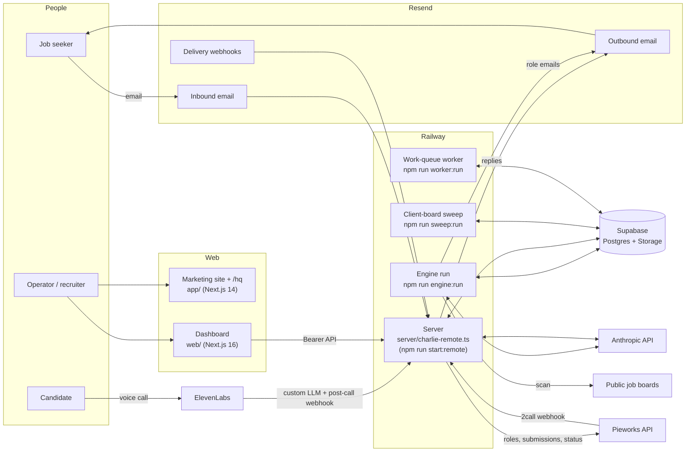

# Charlie

Charlie is an email-first recruiting agent. A person talks to Charlie only by email. There is no app to install and no account to create.

Charlie has these parts:

- **Job-seeker engine.** It scans public job boards (Greenhouse, Lever, Ashby, SmartRecruiters, Recruitee, Workable, Kula, Workday, Eightfold, Amazon and others), matches each role against each person's profile, and emails the person the roles that fit. Every claim about a person is checked against their own material before it is sent.
- **Email onboarding.** A person sends a CV (or a few lines about their work) to the start address. Charlie builds a grounded profile from it and replies. Later replies change preferences, answer questions, pause or unsubscribe.
- **Outreach agents.** The hiring side has an agent called **Qualify & Submit**. It takes an employer's open roles, finds people in the talent pool who fit, asks each one by email for consent and missing details, and submits the ones a human approves.
- **Pieworks 2call activation.** Pieworks sends people who have waited in its "2call" stage for a week. Charlie asks each one, once, if they are still interested. A "yes" moves them to "interested" in Pieworks.
- **Voice verification.** A candidate opens a link and has a short voice conversation (ElevenLabs). Charlie turns the transcript into an evidence-backed report for a human reviewer.
- **Outreach inbox.** A read-only API that shows every email sent about a role and every reply, one thread per person.
- **Dashboard.** A Next.js app in [web/](web/) for the hiring workspace (Inbox, Agents, voice studio, the candidate call page).

Built by Jibin Michael.

## How the parts fit



## Repository map

| Path | What it is |
|---|---|
| [server/](server/) | The long-running Express server: inbound email, webhooks, signed links, and the hiring APIs ([server/charlie-remote.ts](server/charlie-remote.ts), [server/agents.ts](server/agents.ts), [server/outreach.ts](server/outreach.ts), [server/voice.ts](server/voice.ts)). |
| Root `*.mjs` files | The engine and its steps: [scan-jobs.mjs](scan-jobs.mjs), [yc-ingest.mjs](yc-ingest.mjs), [india-ingest.mjs](india-ingest.mjs), [scheduler.mjs](scheduler.mjs), [match-batch.mjs](match-batch.mjs), [quality-gate.mjs](quality-gate.mjs), [presend-guard.mjs](presend-guard.mjs), [composer.mjs](composer.mjs), [grounding-verify.mjs](grounding-verify.mjs), [render-email.mjs](render-email.mjs), [email-kit.mjs](email-kit.mjs), [email-onboard.mjs](email-onboard.mjs), [charlie-store.mjs](charlie-store.mjs) (all database access), plus the monitors [preflight.mjs](preflight.mjs), [health-check.mjs](health-check.mjs), [watchdog.mjs](watchdog.mjs), [run-eval.mjs](run-eval.mjs). Root `*.test.mjs` files are their tests. |
| [lib/](lib/) | Shared modules. Key ones: [lib/send-guard.mjs](lib/send-guard.mjs) (the one send door), [lib/agents/](lib/agents/) (agent registry and runner), [lib/qualify/](lib/qualify/) (Qualify & Submit), [lib/scoring/](lib/scoring/) (pluggable candidate scorer), [lib/pieworks-activation.mjs](lib/pieworks-activation.mjs), [lib/connections/pieworks.mjs](lib/connections/pieworks.mjs), [lib/schemas/](lib/schemas/) (Zod schemas for every external boundary and model output), [lib/heartbeat.mjs](lib/heartbeat.mjs). |
| [prompts/](prompts/) | System prompts, one file per model task. Output schemas live in [lib/schemas/](lib/schemas/). |
| [voice/](voice/) | Voice verification: plan, live turn controller, consent, transcript pipeline, evidence validation, evaluation, report. |
| [emails/](emails/) | Email design tokens ([emails/tokens.mjs](emails/tokens.mjs)), fixtures and snapshot tests. The templates themselves are in [email-kit.mjs](email-kit.mjs), [render-email.mjs](render-email.mjs) and the other `render-*.mjs` files. |
| [evals/](evals/) | The grounding regression gate. See [evals/README.md](evals/README.md). |
| [supabase/](supabase/) | Supabase CLI config and SQL migrations. |
| [scripts/](scripts/) | Operator tools. See [scripts/README.md](scripts/README.md). |
| [app/](app/) | Next.js 14 site at the repo root: landing page, privacy and terms, the voice-verification dashboard at `/hq/<secret>`, and a report page at `/hiring`. |
| [web/](web/) | Next.js 16 dashboard with its own `package.json`: the hiring workspace (Inbox, Agents), the voice studio and the candidate call page `/v/<token>`. [web/.npmrc](web/.npmrc) sets `legacy-peer-deps=true` so `npm ci` accepts its React 19 peer ranges. |
| [web/app/](web/app/) | Dashboard routes: `hq/[secret]/` (workspace, studio, candidates; the secret is `VOICE_DASHBOARD_SECRET`), `v/[token]/` (the candidate call page), and `api/logo/` (`GET /api/logo`, a company-logo lookup). |
| [web/components/](web/components/) | Dashboard components: `shared/` (logo tiles, tooltips, icons), `shell/` (page frame, buttons, fields), `ui/` (shadcn primitives), `verify/` (voice verification views), `workspace/` (Inbox, Agents). |
| [web/lib/](web/lib/) | Dashboard API clients for the server (`api.ts`, `agents-api.ts`, `outreach-api.ts`, `session-api.ts`), shared types, formatting and path helpers, and its own tests (`*.test.mjs`). |
| [data/](data/) | Seed data. See [data/india-seed.README.md](data/india-seed.README.md). |
| [public/](public/) | Static assets for the root site. [public/fonts/](public/fonts/) holds Courier Prime (OFL, see [public/fonts/OFL.txt](public/fonts/OFL.txt)); [public/logos/](public/logos/) holds third-party company, ATS and mail-provider logos (trademarks of their owners, not MIT; see [NOTICE](NOTICE)). |
| [composer.md](composer.md), [dossier.md](dossier.md), [matcher.md](matcher.md) | Runtime prompt specs that live at the root (read by the engine at run time); every other prompt is in [prompts/](prompts/). |
| [resume-pdf.tsx](resume-pdf.tsx), [sanchez-font.mjs](sanchez-font.mjs), [sanchez-ttf.mjs](sanchez-ttf.mjs) | The react-pdf resume and cover-letter template (run under `tsx`) and the Sanchez font embedded as base64 for emails (woff2) and PDFs (TTF). Sanchez is OFL, see [NOTICE](NOTICE). |
| [instrumentation.ts](instrumentation.ts), [instrumentation-client.ts](instrumentation-client.ts), [sentry.server.config.ts](sentry.server.config.ts), [sentry.edge.config.ts](sentry.edge.config.ts) | Sentry set-up for the root site (Next.js instrumentation hooks). A no-op without a DSN. |
| [tsconfig.typecheck.json](tsconfig.typecheck.json) | The stricter config behind `npm run typecheck` (covers `app/` and `server/`). |
| [.githooks/](.githooks/) | An optional pre-push hook that runs typecheck, lint, tests, build and the migration guard. Enable with `git config core.hooksPath .githooks`. |
| [.railwayignore](.railwayignore), [.vercelignore](.vercelignore) | What `railway up` and the Vercel deploy must not upload (local agent state, large engine output). |
| `watchlist*.json`, [seed-companies.json](seed-companies.json) | The companies and job boards the scanner reads. |
| [worker.mjs](worker.mjs), [sweep.mjs](sweep.mjs) | The work-queue worker and the client-board sweep (each its own Railway service). |
| `railway*.json`, [vercel.json](vercel.json) | Deploy configs. Each `railway*.json` is one Railway service (server, engine, sweep, worker). [vercel.json](vercel.json) declares one Vercel service: the Next.js app at the repo root (the site in `app/`), served at `/`. It does not deploy `web/`; deploy the dashboard as a separate project with root directory `web/`. See [docs/SETUP.md](docs/SETUP.md). |
| [.env.example](.env.example), [web/.env.example](web/.env.example) | Every environment variable, with a one-line description. |

## Quick start

You need Node.js 22 (the root [package.json](package.json) pins `"node": "22.x"`), npm, and the [Supabase CLI](https://supabase.com/docs/guides/local-development/cli/getting-started).

1. **Clone and install.**

   ```sh
   git clone https://github.com/jibinmichael/charlie.git
   cd charlie
   npm ci
   (cd web && npm ci)
   ```

2. **Create your env file.** Copy both examples. The inline `# comments` are fine: the env loader strips them, as `node --env-file` does.

   ```sh
   cp .env.example .env.local
   cp web/.env.example web/.env.local
   ```

   Then fill in at least the "REQUIRED" block. [docs/SETUP.md](docs/SETUP.md) says where each value comes from. [docs/CONFIGURATION.md](docs/CONFIGURATION.md) lists every variable.

3. **Create the database.** Make a Supabase project, link it and apply the migrations:

   ```sh
   supabase login
   supabase link --project-ref <your-project-ref>
   supabase db push
   npm run db:types
   ```

   The migrations also create the private Storage buckets `resumes` and `cvs`; the other two are created by the code on first write (see [docs/SETUP.md](docs/SETUP.md#storage-buckets)).

4. **Run the server.**

   ```sh
   npm run start:remote        # listens on PORT (default 8787); GET /healthz
   ```

   The server refuses to start without `INBOUND_WEBHOOK_SECRET` or `RESEND_WEBHOOK_SECRET`.

5. **Run the engine once.**

   ```sh
   npm run engine:scan         # preflight + scan only; emails no person
   EMAIL_DRY_RUN=1 npm run engine:run   # the full chain; role emails and the newsletter are previews
   ```

   Neither command emails a person. Both can email **you**: preflight and the health check (and the watchdog in `engine:run`) send operator alerts to `WATCHDOG_TO` / `ALERT_EMAIL` / `OWNER_EMAIL` when a check fails. Leave those empty locally. Run against a test database whose only active people are addresses you control. (Preflight fails without `RESEND_API_KEY`, so an empty key stops the whole chain.)

6. **Run the web apps.**

   ```sh
   npm run dev                 # root site (app/) on http://localhost:3000
   (cd web && npm run dev -- -p 3001)   # dashboard (web/) on http://localhost:3001; open /hq/<VOICE_DASHBOARD_SECRET>
   ```

7. **Run the tests.**

   ```sh
   npm test                    # Vitest suite + the plain-node guard tests
   npm run typecheck
   npm run lint
   (cd web && npm test && npm run typecheck && npm run lint && npm run build)
   ```

## Documentation

- [docs/SETUP.md](docs/SETUP.md): accounts, database, DNS, local run and deploy.
- [docs/CONFIGURATION.md](docs/CONFIGURATION.md): every environment variable.
- [docs/ARCHITECTURE.md](docs/ARCHITECTURE.md): components, data flows and the data model.
- [docs/PIEWORKS_2CALL.md](docs/PIEWORKS_2CALL.md): the Pieworks 2call activation, end to end.
- [docs/OPERATIONS.md](docs/OPERATIONS.md): daily operation, monitoring and common failures.
- [SECURITY.md](SECURITY.md): how secrets and webhooks are handled, and how to report a vulnerability (privately, through GitHub).
- [CONTRIBUTING.md](CONTRIBUTING.md): tests and code conventions.
- [CODE_OF_CONDUCT.md](CODE_OF_CONDUCT.md): the Contributor Covenant 2.1.

## Licence

The code is MIT. See [LICENSE](LICENSE).

Some bundled material is not MIT: the fonts (SIL Open Font License 1.1), the third-party logos under `public/logos/` (trademarks of their owners, used only for identification) and the company lists compiled from public job boards. [NOTICE](NOTICE) lists each one.
