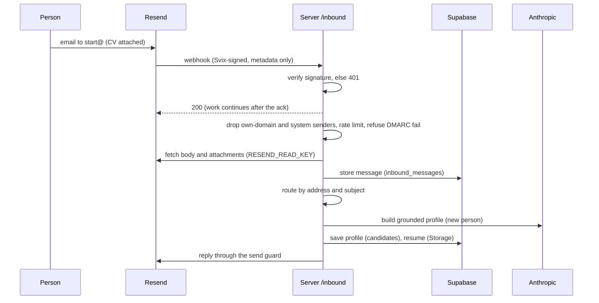
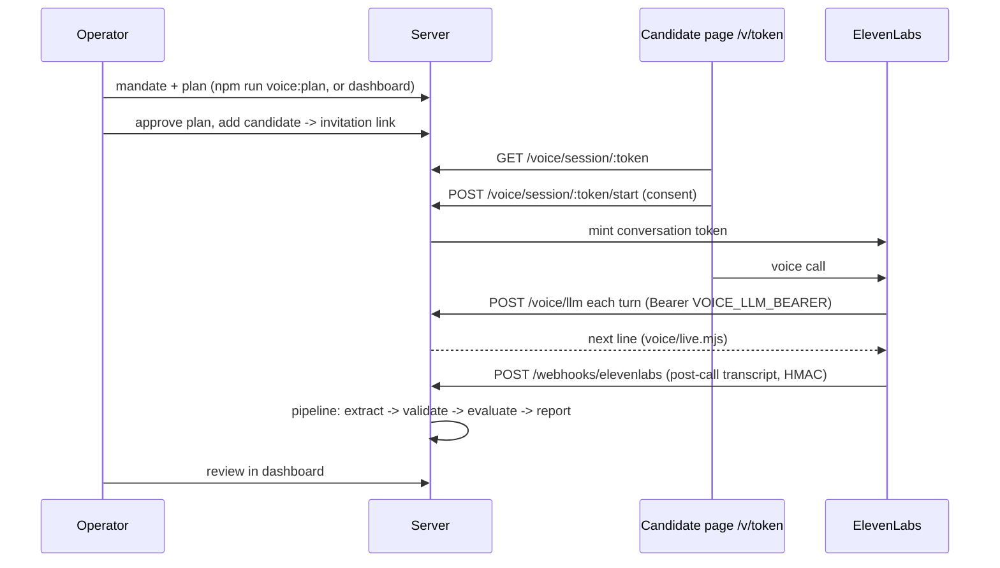

# Architecture

This page explains how Charlie's parts work and how data moves between them. For setup, see [SETUP.md](SETUP.md). For variables, see [CONFIGURATION.md](CONFIGURATION.md).

## Contents

1. [Components](#components)
2. [Root module index](#root-module-index)
3. [The daily engine run](#the-daily-engine-run)
4. [Email onboarding and replies (`/inbound`)](#email-onboarding-and-replies-inbound)
5. [The send guard](#the-send-guard)
6. [Agents](#agents)
7. [The pluggable candidate scorer](#the-pluggable-candidate-scorer)
8. [Outreach inbox API](#outreach-inbox-api)
9. [Voice verification](#voice-verification)
   - [Voice verification invariants](#voice-verification-invariants)
10. [HTTP routes](#http-routes)
11. [Data model](#data-model)

## Components

| Component | Entry point | Runs as |
|---|---|---|
| Server | [server/charlie-remote.ts](../server/charlie-remote.ts) (Express, run with `tsx`) | One always-on process. Handles inbound email, webhooks, signed links and the hiring APIs, and runs timers for the sweeps. |
| Engine | `npm run engine:run` in [package.json](../package.json) | A batch job. Scans job boards, matches, sends role emails, then checks itself. Exits when done. |
| Client-board sweep | [sweep.mjs](../sweep.mjs) | A batch job. Moves Tally applicants into the talent pool, scores them for a client mandate and writes Notion board rows. |
| Worker | [worker.mjs](../worker.mjs) | A loop that claims rows from the `hire_work` queue under a lease ([lib/work-store.mjs](../lib/work-store.mjs), [lib/work-runner.mjs](../lib/work-runner.mjs)). Today it runs only the `work.ping` kind. New kinds register a handler in `worker.mjs`. |
| Root site | [app/](../app/) (Next.js 14) | Landing page, legal pages, voice dashboard at `/hq/<secret>`. |
| Dashboard | [web/](../web/) (Next.js 16) | Hiring workspace (Inbox, Agents), voice studio, candidate call page `/v/<token>`. Holds no keys; calls the server with a Bearer token. |
| Database | Supabase Postgres and Storage | All state. Every read and write goes through [charlie-store.mjs](../charlie-store.mjs) or a feature store module with the service-role key. |

Shared rules that every component follows:

- **External data is parsed at the boundary.** Webhook bodies, partner API replies, job-board feeds and model outputs pass a Zod schema in [lib/schemas/](../lib/schemas/) before use. A record that does not parse is logged and skipped. The batch goes on.
- **Fail closed on sends, fail open on monitoring.** If Charlie cannot prove a send is safe, it does not send. A failed heartbeat or log write never stops a job.
- **Grounding.** Every claim about a person in an email must come from that person's own material. [grounding-verify.mjs](../grounding-verify.mjs) re-reads the source and flags invented or inflated claims. [grounding-enforce.mjs](../grounding-enforce.mjs) drops flagged claims or holds the send.

## Root module index

The engine modules at the repo root, one line each, from each file's header comment. Tests (`*.test.mjs`), `next.config.mjs`, `vitest.config.mjs` and the generated `next-env.d.ts` are not listed. Shared helpers live in [lib/](../lib/).

### Onboarding

- [email-onboard.mjs](../email-onboard.mjs) — onboarding and profile edits by email; the sender's address is the identity and the attached resume is the source of truth.
- [dossier-build.mjs](../dossier-build.mjs) — builds a grounded first-draft dossier from a resume only.
- [company-context.mjs](../company-context.mjs) — best-effort enrichment of what a person's past employers do.
- [url-ingest.mjs](../url-ingest.mjs) — turns links a person sends (GitHub and others) into grounded dossier sources, tiered by how verifiable they are.
- [experience-years.mjs](../experience-years.mjs) — reads a person's professional years off their resume, for the knockout floor.
- [edge-verify.mjs](../edge-verify.mjs) — a second, independent check that a person's claimed "edge" is grounded and how rare it is.
- [journey.mjs](../journey.mjs) — the onboarding and lifecycle state machine (pure, no I/O); every state delivers or communicates.
- [journey-watchdog.mjs](../journey-watchdog.mjs) — fires a due journey watchdog timer so nobody falls into silence.
- [game-plan.mjs](../game-plan.mjs) — the "game plan" onboarding email and the reply loop that lets a person change it.
- [first-role.mjs](../first-role.mjs) — right after onboarding, finds the single best above-bar role and emails it; sends nothing if none clears the bar.
- [render-invite.mjs](../render-invite.mjs) — `computeMissing`: which real preference fields a dossier still lacks.
- [confirm-sweep.mjs](../confirm-sweep.mjs) — sends the one-time "you're in" card to invited people who have finished their dossier.
- [completeness-nudge.mjs](../completeness-nudge.mjs) — nudges people who get no roles (usually thin input) to add to their profile.
- [depth-question.mjs](../depth-question.mjs) — the depth-question email: a real market read, then one question.
- [profile-depth.mjs](../profile-depth.mjs) — counts grounded proof points per person, with a time series.
- [represent.mjs](../represent.mjs) — asks permission to put a person in front of a headhunter or startup, and completes the profile that needs.
- [wedge.mjs](../wedge.mjs) — the wedge drip: names the rare, grounded combination in a person's background as their edge.
- [cv-check.mjs](../cv-check.mjs) — `check@`: a grounded, honest scorecard of a CV against one job.
- [track.mjs](../track.mjs) — `track@`: classifies a forwarded company reply into an application stage, extracting only what the email says.

### Scan and ingest

- [scan-jobs.mjs](../scan-jobs.mjs) — the multi-ATS job scanner: sourcing and freshness; writes the job pool.
- [scan-boards.mjs](../scan-boards.mjs) — extra remote job boards, normalised and merged into the scan with dedup.
- [scan-health.mjs](../scan-health.mjs) — tells "this board is empty" apart from "this board stopped answering us".
- [resolve-ats.mjs](../resolve-ats.mjs) — turns a company (slug, website or name) into its live ATS board.
- [ingest-core.mjs](../ingest-core.mjs) — shared machinery for the segment ingesters (resolve, dedupe, write a watchlist).
- [yc-ingest.mjs](../yc-ingest.mjs) — daily: turns YC's hiring list into watchlist entries.
- [india-ingest.mjs](../india-ingest.mjs) — daily: grows India coverage as a tracked segment.
- [discover-companies.mjs](../discover-companies.mjs) — builds a watchlist by probing a public company list against the ATS endpoints.
- [freshness.mjs](../freshness.mjs) — freshness as a send-selection signal, not only a badge.

### Match

- [match-batch.mjs](../match-batch.mjs) — the high-volume match step: all (person, job) pairs as one Message Batches request.
- [match-jobs.mjs](../match-jobs.mjs) — the matcher CLI: scores scanned jobs against one dossier using the rubric in `matcher.md`.
- [match-one.mjs](../match-one.mjs) — on-demand match of one good role for one person.
- [pre-filter.mjs](../pre-filter.mjs) — cheap rule-based pre-filter (no model) between the scanner and the matcher.
- [select-jobs.mjs](../select-jobs.mjs) — deterministic per-person pre-filter before the per-user job cap.
- [eligibility-gate.mjs](../eligibility-gate.mjs) — the knockout floor: hard reasons a role is structurally wrong for a person.
- [role-reqs.mjs](../role-reqs.mjs) — deterministic extraction of a role's hard requirements from ATS fields and JD text.
- [fit-coverage.mjs](../fit-coverage.mjs) — grounded JD-to-coverage engine: which requirements are met, partial or unknown.
- [fit-floor.mjs](../fit-floor.mjs) — the evidence-based fit floor that gates a solo send.
- [unify.mjs](../unify.mjs) — one grounded composite score used by both the send gate and the email readout.
- [remote-access-verify.mjs](../remote-access-verify.mjs) — a cheap model check of whether an ambiguous remote role is workable from the person's region.

### Compose and render

- [composer.mjs](../composer.mjs) — the email composer step; rules live in `composer.md`.
- [email-kit.mjs](../email-kit.mjs) — the shared shell and lifecycle templates for every email.
- [render-email.mjs](../render-email.mjs) — renders the role email in email-safe HTML.
- [render-reply.mjs](../render-reply.mjs) — the replies Charlie sends when someone writes back.
- [render-plan.mjs](../render-plan.mjs) — the "game plan" email.
- [render-confirmation.mjs](../render-confirmation.mjs) — the "you're in" card.
- [threading.mjs](../threading.mjs) — keeps related mail in one conversation and unrelated mail apart.
- [resume-build.mjs](../resume-build.mjs) — a tailored, grounded resume and cover letter for one role.
- [resume-pdf.tsx](../resume-pdf.tsx) — the ATS-safe PDF template for the resume and cover letter.
- [tailored-docs.mjs](../tailored-docs.mjs) — builds the two PDFs that go with every role email.
- [sanchez-font.mjs](../sanchez-font.mjs) — the Sanchez heading font as a woff2 data URI for email (SIL OFL 1.1).
- [sanchez-ttf.mjs](../sanchez-ttf.mjs) — the Sanchez font as a TTF data URI for the PDFs (SIL OFL 1.1).

### Send and guards

- [scheduler.mjs](../scheduler.mjs) — the scheduled engine entry point: match, gate, compose and send for every active person.
- [run-charlie.mjs](../run-charlie.mjs) — the send step for one person (`CHARLIE_USER_EMAIL`).
- [presend-guard.mjs](../presend-guard.mjs) — the gate every role send must pass last: no repeats, plus the quality gate.
- [quality-gate.mjs](../quality-gate.mjs) — routes each candidate role to send, digest or drop.
- [drip-guard.mjs](../drip-guard.mjs) — the gate every lifecycle drip calls before it sends; fails closed.
- [grounding-verify.mjs](../grounding-verify.mjs) — the honesty gate: flags invented or inflated claims about a person.
- [grounding-enforce.mjs](../grounding-enforce.mjs) — drops flagged claims at send time, or holds the send.
- [send-audit.mjs](../send-audit.mjs) — after a send, re-reads the role against the person's hard constraints and flags a likely miss.

### Campaigns

- [campaign-loop.mjs](../campaign-loop.mjs) — the `join@` hiring campaign state machine; off until `JOIN_CAMPAIGN=on`.
- [campaign-gate.mjs](../campaign-gate.mjs) — the campaign's deterministic gates: "onboarded first" and parsing the owner's verdict.
- [campaign-rules.mjs](../campaign-rules.mjs) — the campaign's rules and guardrails in one place.
- [campaign-board.mjs](../campaign-board.mjs) — the reject explainer: the role's skills ranked, and which ones the resume showed.
- [campaign-stall.mjs](../campaign-stall.mjs) — one nudge for an applicant who stopped answering.
- [render-campaign.mjs](../render-campaign.mjs) — the campaign's email templates.
- [announce-checkin.mjs](../announce-checkin.mjs) — a "how's it going?" check-in to people who have received roles.
- [announce-hiring.mjs](../announce-hiring.mjs) — the "State of Hiring" note to active users.
- [announce-referral.mjs](../announce-referral.mjs) — the warm-intro finder announcement.
- [newsletter.mjs](../newsletter.mjs) — the one-time thesis note to new users.
- [digest.mjs](../digest.mjs) — the weekly digest of near-miss roles, re-verified before sending.
- [digest-select.mjs](../digest-select.mjs) — the digest's selection rule, kept separate so it can be tested.

### Referrals

- [referral-find.mjs](../referral-find.mjs) — the warm-intro finder: one real, verified person at the company.
- [referral-draft.mjs](../referral-draft.mjs) — drafts the grounded intro the person sends themselves.
- [referral-inline.mjs](../referral-inline.mjs) — the one referral contact shown inside a role email, with its intro note.

### Reports and market

- [market-report.mjs](../market-report.mjs) — "State of Your Market": a code-computed market report for one person.
- [render-market-report.mjs](../render-market-report.mjs) — renders that report as an email.
- [market-briefing.mjs](../market-briefing.mjs) — sends the market briefing once, as the second onboarding email.
- [market-gap.mjs](../market-gap.mjs) — the weekly market-gap email when a profile keeps just missing roles.
- [market-research.mjs](../market-research.mjs) — the evidence layer for the market-gap email.
- [market-weave.mjs](../market-weave.mjs) — market patterns in the role email, as literal counts over the person's matched roles.
- [role-intel.mjs](../role-intel.mjs) — US-only "Pay vs market" and "Hiring momentum" data for the role email; null when unsure.
- [bls-wage.mjs](../bls-wage.mjs) — the BLS median wage for a title and US metro.

### Ops and monitoring

- [preflight.mjs](../preflight.mjs) — the system check before anything sends; exits non-zero to stop the run.
- [health-check.mjs](../health-check.mjs) — canary for the profile build and the ATS sources; emails an alert on failure.
- [watchdog.mjs](../watchdog.mjs) — end-to-end and honesty checks; emails the owner a report when something is off.
- [run-eval.mjs](../run-eval.mjs) — grades a run against known failure modes and writes one row.
- [stats.mjs](../stats.mjs) — per-run counters and a rolling history (observe only).
- [scheduler-e2e.mjs](../scheduler-e2e.mjs) — proves a scheduled run matches and emails end to end (`npm run scheduler:test`).
- [worker.mjs](../worker.mjs) — the work-queue worker; claims `hire_work` rows under a lease.
- [instrumentation.ts](../instrumentation.ts) — Next.js hook that loads the Sentry config for the active runtime.
- [instrumentation-client.ts](../instrumentation-client.ts) — Sentry for the browser (error monitoring only, PII scrubbed).
- [sentry.server.config.ts](../sentry.server.config.ts) — Sentry for the Next.js server.
- [sentry.edge.config.ts](../sentry.edge.config.ts) — Sentry for Next.js edge code.

### Other

- [charlie-store.mjs](../charlie-store.mjs) — the per-user Supabase seam (service-role key, backend only), and the signed-token helpers.
- [safe-fetch.mjs](../safe-fetch.mjs) — SSRF guard for every server-side fetch of a URL from user or job data.
- [sweep.mjs](../sweep.mjs) — the twice-daily client-board sweep: Tally applicants to a client's Notion board.

## The daily engine run

`npm run engine:run` is one shell chain. `&&` stops the chain on a failure; `;` continues.

```
preflight --phase=pre-scan
  && presend-guard.test.mjs
  && ( yc-ingest ; india-ingest ; scan-jobs ; true )
  && preflight --phase=pre-send
  && ( scheduler ; newsletter --cron )
; health-check
; watchdog --cron
; run-eval
```

| Step | File | What it does |
|---|---|---|
| 1 | [preflight.mjs](../preflight.mjs) `--phase=pre-scan` | Checks that the guard logic still blocks known bad sends, that Supabase and Anthropic answer, and that required variables are set. Fails the chain and emails `WATCHDOG_TO` if not. Records the build id of the running code. |
| 2 | [presend-guard.test.mjs](../presend-guard.test.mjs) | Runs the pre-send guard's own tests. A broken guard stops the run. |
| 3 | [yc-ingest.mjs](../yc-ingest.mjs), [india-ingest.mjs](../india-ingest.mjs) | Resolve company lists (a public YC feed, [data/india-seed.json](../data/india-seed.json)) to live ATS boards with [resolve-ats.mjs](../resolve-ats.mjs). They write `watchlist-yc.json` and `watchlist-india.json`. Failures here do not stop the run. |
| 3 | [scan-jobs.mjs](../scan-jobs.mjs) | Reads `watchlist*.json`, fetches every board, normalises postings, applies freshness rules and writes the pool: `jobs.json` locally and `job-pool/latest.json` in Storage (and `job_pool` rows when `POOL_TABLE=on`). Writes `/pool-stats` and `/pool-feed` data. |
| 4 | [preflight.mjs](../preflight.mjs) `--phase=pre-send` | Checks the pool has more than 1,000 roles and was scanned within `POOL_MAX_AGE_HOURS`. Otherwise no send. |
| 5 | [scheduler.mjs](../scheduler.mjs) | For every active person: match the pool against their profile ([match-batch.mjs](../match-batch.mjs), Message Batches API, with a hard spend cap `MAX_RUN_COST_USD`), select candidates ([select-jobs.mjs](../select-jobs.mjs)), route each to send, digest or drop ([quality-gate.mjs](../quality-gate.mjs): liveness, location reach, language, fit floor), apply the no-repeat rules ([presend-guard.mjs](../presend-guard.mjs)), compose ([composer.mjs](../composer.mjs) with [composer.md](../composer.md)), verify grounding, render ([render-email.mjs](../render-email.mjs)) and send through the send guard. Near-misses are stored for the weekly digest. Pings the `match_send` and `coverage` heartbeats. |
| 5 | [newsletter.mjs](../newsletter.mjs) `--cron` | A one-time note to people onboarded at least a day ago. |
| 6 | [health-check.mjs](../health-check.mjs) | Canary: a weekly real profile build of a fixed resume, and a probe of each ATS source. Emails `ALERT_EMAIL` on failure. |
| 7 | [watchdog.mjs](../watchdog.mjs) `--cron` | Honesty and integrity checks: no application stage without evidence, every profile claim has a source, no repeat or ineligible send, the server and engine run the same code and config, heartbeats configured. Emails `WATCHDOG_TO` on failure. |
| 8 | [run-eval.mjs](../run-eval.mjs) | Grades the run (no model calls, no writes except one `run_eval` row in `signals`). |

Steps 6 to 8 run even when an earlier step failed.

## Email onboarding and replies (`/inbound`)

Resend receives mail for the mail domain and POSTs a webhook to `/inbound`. The handler is in [server/charlie-remote.ts](../server/charlie-remote.ts).



Steps, in order:

1. **Signature.** `INBOUND_WEBHOOK_SECRET`, then `RESEND_WEBHOOK_SECRET`. A bad signature is a 401. The server acks with 200 before doing the work.
2. **Guards.** Mail from Charlie's own domain or from system senders (mailer-daemon, no-reply) is ignored. A sender over `INBOUND_MAX_PER_HOUR` is dropped silently ([lib/inbound-rate.mjs](../lib/inbound-rate.mjs)). An explicit DMARC fail is refused.
3. **Body and files.** The body and up to `MAX_ATTACHMENTS` attachments are fetched from the Resend Receiving API. Text is extracted ([server/resume-extract.mjs](../server/resume-extract.mjs)). The message is stored in `inbound_messages` before any routing.
4. **Routing.** The first match wins:
   - `pieworks+<key>@`: a 2call reply ([PIEWORKS_2CALL.md](PIEWORKS_2CALL.md)).
   - `apply+<key>@`: a Qualify & Submit reply ([server/agents.ts](../server/agents.ts) `qualifyInboundReply`).
   - `join@` when `JOIN_CAMPAIGN=on`: the hiring-campaign flow ([campaign-loop.mjs](../campaign-loop.mjs)). A human casts every verdict.
   - `intro@`: warm-intro finder ([referral-find.mjs](../referral-find.mjs)).
   - Replies about the person's own work, client-status replies, `check@` (fit scorecard, [cv-check.mjs](../cv-check.mjs)), `track@` (application tracking, [track.mjs](../track.mjs)), `chase+<token>@` (interest in a role).
   - Button replies matched by subject (represent, Pro interest, depth answer, outcome).
   - `pause` / `restart` commands ([lib/pause-command.mjs](../lib/pause-command.mjs)).
   - **New person with a CV:** build a grounded profile ([email-onboard.mjs](../email-onboard.mjs), [dossier-build.mjs](../dossier-build.mjs), [prompts/onboard-extract.mjs](../prompts/onboard-extract.mjs)), store the resume, send the welcome, then the market briefing ([market-briefing.mjs](../market-briefing.mjs)). With `ONBOARDING_V2=on`, a short question loop runs first ([journey.mjs](../journey.mjs)). If the build fails, an `onboard_retry` task retries up to three times.
   - **New person without a CV:** a real bio is enough; otherwise Charlie asks one question.
   - **Existing person:** answers to Charlie's own questions are filed, questions are answered from the record or acknowledged, and only a message classified as a clear instruction may change preferences ([lib/inbound-intent.mjs](../lib/inbound-intent.mjs), [prompts/inbound-intent.mjs](../prompts/inbound-intent.mjs)).
5. **Reply.** Every reply goes through the send guard and threads into one conversation per person.

Delivery events arrive on `/webhooks/resend`. Every event is logged in `email_events`. A hard bounce or a complaint adds the address to `suppressions`.

## The send guard

Every user-facing email goes through one function: `sendGuarded` in [lib/send-guard.mjs](../lib/send-guard.mjs). It does these steps in order:

1. **Suppression.** A suppressed address gets nothing. One exception: `/inbound` passes its own check, so a person who unsubscribed and then writes in still gets a reply. A bounce or a complaint still blocks that reply ([lib/suppression-policy.mjs](../lib/suppression-policy.mjs)).
2. **Leak check.** [lib/leak-lint.mjs](../lib/leak-lint.mjs) blocks a message that contains an internal identifier (a column name, for example). Status `leak_blocked`.
3. **Idempotency.** An atomic claim on `(email, template, dedupe_key)` in `sent_emails`. A second claim loses and the send is skipped as `duplicate`. On a failed send the claim is released.
4. **Send.** `resend.emails.send` with Resend's own idempotency key. The Resend id, subject and body are stored on the `sent_emails` row.

It returns `sent`, `suppressed`, `duplicate`, `leak_blocked` or `failed`.

Before the send guard, any email about a specific role must pass `preSendGuard` in [presend-guard.mjs](../presend-guard.mjs). It never sends the same role twice (same apply URL, same company and title, same title stem) and applies a per-company cool-off.

Other send discipline:

- **Drip limits.** [drip-guard.mjs](../drip-guard.mjs) holds a per-type cooldown and a global minimum gap between lifecycle emails.
- **Payload schema.** Direct sends are validated against [lib/schemas/resend-send.mjs](../lib/schemas/resend-send.mjs) first.
- **Ask preflight.** A send that expects a reply calls [lib/ask-preflight.mjs](../lib/ask-preflight.mjs). It refuses when the running server's build id (`CHARLIE_HEALTH_URL`) differs from the sending code, because the server might not know how to read the reply.
- **Tests.** [lib/send-doors.test.mjs](../lib/send-doors.test.mjs) fails if code calls `resend.emails.send` outside the allowed places. [sender-gate.test.mjs](../sender-gate.test.mjs) fails if a role sender skips `preSendGuard`.

## Agents

The hiring side runs agents. The code is in [lib/agents/](../lib/agents/), [lib/qualify/](../lib/qualify/) and [server/agents.ts](../server/agents.ts). All of it is off until `HIRING_WORKSPACE=on`.

### Registry

[lib/agents/registry.mjs](../lib/agents/registry.mjs) lists the agents. There is one: **Qualify & Submit** (id `outreach`). Its modes are `off` and `auto`. Shared limits: 30 emails per India day (`daily_cap`), and quiet hours from 21:00 to 09:00 India time. A row in `hire_agents` overrides the defaults.

### Runner

[lib/agents/engine.mjs](../lib/agents/engine.mjs) runs every agent through the same rules:

- one run per agent at a time,
- `off` means off, and an agent that is not built never runs,
- quiet hours and the daily cap,
- every run is recorded in `hire_agent_runs`, including skipped runs and why; an agent that cannot record a run does not run.

### Schedule

The server calls `runAgentsSweep` every 15 minutes. You can also start a run with `POST /agents/api/agents/:id/run`.

### Qualify & Submit

[lib/qualify/agent.mjs](../lib/qualify/agent.mjs). Each employer system is a **connection** (`hire_connections`) with its own mode: `off`, `shadow` (does everything except send and submit) or `live`. The migration seeds a `pieworks` connection in `off`. Adapters are in [lib/qualify/adapters.mjs](../lib/qualify/adapters.mjs).

Each run, per connection:

1. **Full pass** (at most every 11 hours): sync the employer's roles ([lib/qualify/roles.mjs](../lib/qualify/roles.mjs)), score the talent pool for each open role with the [candidate scorer](#the-pluggable-candidate-scorer), and open a thread with the best fits. The first email asks consent to be put forward and asks only for what the employer needs and the record lacks. Batch size and per-role cap come from the connection's settings.
2. **Timers:** one reminder 48 hours after an unanswered email; closed 96 hours after it.
3. **Answered threads:** answers are filed word for word ([lib/qualify/answers.mjs](../lib/qualify/answers.mjs)), the person is judged again, then the agent asks one follow-up at most, or moves on.
4. **Confirm:** one email lists exactly what will be sent. Only a reply that is a clear YES makes the thread ready.
5. **Submit:** only when a human has approved the person in the Inbox (`POST /agents/api/threads/:id/approval`). The submission carries a justification built only from the person's own words and checked for grounding. A person is submitted for a role at most once (`hire_submissions`).

Replies arrive at `apply+<key>@` and go through `/inbound`. Only the person's own address can answer.

### Draft and approve

The runner also supports agents in `draft` mode: an email is stored in `hire_agent_drafts` and waits. `POST /agents/api/drafts/:id/approve` sends the exact stored email through the send guard, after an optional re-check. The draft moves out of `pending` before sending, so two clicks never send twice. `POST /agents/api/drafts/:id/reject` discards it. Qualify & Submit itself does not use draft mode; its control is the connection mode and the Inbox approval.

## The pluggable candidate scorer

[lib/scoring/index.mjs](../lib/scoring/index.mjs) decides who Qualify & Submit may contact and later submit. Nothing else in the code decides fit for that agent.

`CANDIDATE_SCORER` picks the scorer:

| Name | Behaviour |
|---|---|
| `pieworks` (default) | Uses the AI score Pieworks sends in its 2call webhook (stored in `pieworks_activations.candidate`). Passes at or above `PIEWORKS_SCORE_THRESHOLD` (default 70). No score means no pass. |
| `none` | Everyone passes with no score. Use it when a human reviews every person. Consent and Inbox approval still apply. |

An unknown name throws, so the agent's run fails loudly. A scorer that throws, or returns a malformed result, reads as `{ score: null, pass: false }`.

### Add a scorer

Register a factory before the agent runs, then set `CANDIDATE_SCORER` to its name:

```js
import { registerScorer } from "./lib/scoring/index.mjs";

registerScorer("my-model", ({ env, db }) => ({
  name: "my-model",
  async score(candidate, role) {
    const s = await myModel(candidate, role); // a model, rules or a vendor API
    return { score: s, pass: s >= 60, reasons: ["Has shipped mobile releases"] };
  },
}));
```

- `candidate` has `email`, `full_name`, `current_title`, `current_company`, `total_years`, `city`, `country`, `linkedin_url`, `top_skills`, and after a reply `answers` and `cv_text`.
- `role` has `id`, `external_id`, `source`, `title`, `client`, `location`, `must_haves`, `experience`, `payload`.
- The result must be `{ score: 0..100 | null, pass: boolean, reasons: string[] }` (at most 10 reasons). Reasons are shown to operators only. They are never emailed or sent to an employer.
- `createScorer` is called in [lib/qualify/wiring.mjs](../lib/qualify/wiring.mjs) each time the agent's dependencies are built. The module that calls `registerScorer` must be imported by the server before that (for example at the top of [server/agents.ts](../server/agents.ts)).

## Outreach inbox API

[server/outreach.ts](../server/outreach.ts) is read-only. It shows, for a hand-run role mandate, every email Charlie sent a person and every reply, as one thread per person, with who they are from `talent_pool`. The mandates are listed in [lib/hire-outreach.mjs](../lib/hire-outreach.mjs) (`OUTREACH_MANDATES`).

| Route | Returns |
|---|---|
| `GET /outreach/api/mandates` | The mandates. |
| `GET /outreach/api/mandates/:key` | One mandate's threads, with lifecycle state. |
| `GET /outreach/api/cv/:email` | A person's stored CV text. |
| `GET /outreach/api/messages/:emailId/attachments` | Attachments of one received email. |
| `GET /outreach/api/messages/:emailId/attachments/:attId` | One attachment's bytes. |

All routes are 404 unless `HIRING_WORKSPACE=on`, and need `Authorization: Bearer <VOICE_DASHBOARD_SECRET>`. Browser calls are allowed only from `HIRE_APP_ORIGINS`.

The server also runs a pursuit sync every 15 minutes ([lib/hire-pursuit-sync.mjs](../lib/hire-pursuit-sync.mjs)). It keeps the saved candidate lifecycle (`hire_pursuits`) in step with these emails.

From the command line, [scripts/inbox.mjs](../scripts/inbox.mjs) shows what people wrote to Charlie from `inbound_messages`.

## Voice verification

The code is in [voice/](../voice/) and [server/voice.ts](../server/voice.ts). Every route answers 404 until `VOICE_VERIFICATION=on`.



1. **Plan.** A mandate (job description and hiring questions) becomes a verification plan ([voice/plan.mjs](../voice/plan.mjs)). Each item links a quote in the mandate to a requirement, a question and the evidence it expects. A human approves the plan. Only an approved plan can be used.
2. **Invite.** `POST /voice/api/jobs/:id/candidates` creates a session and returns a link `<VOICE_APP_ORIGIN>/v/<token>`.
3. **Consent and start.** The candidate page shows the consent texts ([voice/consent.mjs](../voice/consent.mjs)). Start records consent, refuses a second live call, mints an ElevenLabs token and returns the first line.
4. **Live turns.** ElevenLabs calls `/voice/llm` for each turn. [voice/live.mjs](../voice/live.mjs) and [voice/controller.mjs](../voice/controller.mjs) pick the next question from the plan. A request that cannot be tied to a live session gets a fixed line and no model call.
5. **Transcript.** The post-call webhook is verified (`ElevenLabs-Signature`, HMAC-SHA256, 30-minute window). The raw payload is stored first. The transcript is written once; a replay changes nothing.
6. **Pipeline.** [voice/pipeline.mjs](../voice/pipeline.mjs): the model only copies evidence out ([voice/extract.mjs](../voice/extract.mjs)); [voice/evidence-validate.mjs](../voice/evidence-validate.mjs) drops any quote not found word for word in the transcript; [voice/evaluate.mjs](../voice/evaluate.mjs) sets statuses by arithmetic; [voice/render-package.mjs](../voice/render-package.mjs) builds the report. Spend per session stops at `VOICE_MAX_PIPELINE_COST_USD`. A sweep every 10 minutes picks up sessions a restart left behind.
7. **Review.** A human reviews the report in the dashboard (`POST /voice/api/calls/:id/review`). Nothing is sent to the candidate.

### Voice verification invariants

Comments and tests in [voice/](../voice/) cite these rules by number ("invariant 3"). The numbers are kept from the original design, so the list has gaps. Each rule is enforced in code and pinned by the tests named.

| # | Rule | Enforced in | Tested in |
|---|---|---|---|
| 2 | Every plan item resolves to something in the mandate (a requirement or a hiring question). An item whose `ref` does not resolve is dropped and reported, never kept. | [voice/plan.mjs](../voice/plan.mjs) | [voice/plan.test.mjs](../voice/plan.test.mjs) |
| 3 | No model chooses the workflow state or the next move. Session state changes only through the transition table in [voice/session.mjs](../voice/session.mjs); the controller decides moves deterministically. The sufficiency judge only gives an optional, shape-checked hint, and a missing hint gives the same decision path. | [voice/session.mjs](../voice/session.mjs), [voice/controller.mjs](../voice/controller.mjs), [voice/judge.mjs](../voice/judge.mjs) | [voice/controller.test.mjs](../voice/controller.test.mjs), [voice/judge.test.mjs](../voice/judge.test.mjs), [voice/live.test.mjs](../voice/live.test.mjs) |
| 4 | Status is computed, not judged. A status is a pure function of validated evidence and the approved contract; the same inputs always give the same status, and a reviewer can recompute it from the coverage inputs shown. | [voice/evaluate.mjs](../voice/evaluate.mjs) | [voice/evaluate.test.mjs](../voice/evaluate.test.mjs) |
| 6 | No status is worse than `insufficient`. Nothing in the evaluator produces a negative verdict about the person. | [voice/evaluate.mjs](../voice/evaluate.mjs) | [voice/evaluate.test.mjs](../voice/evaluate.test.mjs) |
| 7 | `insufficient` and `not_assessed` always carry a reason about the session (audio, refusal, time), never about the person. An evaluator failure gives no status at all: the session is `blocked` and held for review. | [voice/evaluate.mjs](../voice/evaluate.mjs) | [voice/evaluate.test.mjs](../voice/evaluate.test.mjs) |
| 10 | Every move has scripted text. A plan without a fallback line for a move is refused, and the live writer returns the scripted line on any model timeout, error, schema failure or lint failure. It never retries. | [voice/plan.mjs](../voice/plan.mjs), [voice/writer.mjs](../voice/writer.mjs), [voice/fallback.mjs](../voice/fallback.mjs) | [voice/plan.test.mjs](../voice/plan.test.mjs), [voice/writer.test.mjs](../voice/writer.test.mjs), [voice/controller.test.mjs](../voice/controller.test.mjs) |
| 11 | The provenance chain resolves for every signal in the report: audio → transcript turn → quoted evidence → signal. A signal with no evidence must carry a reason, and a broken link is named. Quotes not found word for word in the cited turns are dropped (cite or drop). | [voice/evidence-validate.mjs](../voice/evidence-validate.mjs), [voice/render-package.mjs](../voice/render-package.mjs) | [voice/report-schema.test.mjs](../voice/report-schema.test.mjs), [voice/evidence-validate.test.mjs](../voice/evidence-validate.test.mjs) |
| 13 | A test session (`kind = test`) walks the same states minus human review and release, and can never reference a real candidate; candidate-level reads exclude test sessions. | [voice/session.mjs](../voice/session.mjs), [voice/store.mjs](../voice/store.mjs) | [voice/session.test.mjs](../voice/session.test.mjs), [voice/isolation.test.mjs](../voice/isolation.test.mjs) |

**Failure rules.** Each part that can fail has one fixed safe outcome, and the tests pin it:

- sufficiency judge slow, broken or returning garbage → no hint; the controller's default move (one probe, then move on);
- live writer failure → the scripted line for that move;
- unclear audio (speech-to-text uncertainty) → an audio check, then the item is marked `insufficient_audio`; never a guess;
- extraction failure for an item → that item only is retried or left without evidence; the batch continues;
- evaluator failure → the session is `blocked` and held for human review.

## HTTP routes

All server routes are in [server/charlie-remote.ts](../server/charlie-remote.ts) and the three routers it mounts: [server/voice.ts](../server/voice.ts), [server/outreach.ts](../server/outreach.ts) and [server/agents.ts](../server/agents.ts). No other file in `server/` registers a route.

Shared middleware, in [server/charlie-remote.ts](../server/charlie-remote.ts) and [lib/http-guards.mjs](../lib/http-guards.mjs):

- **Security headers** on every reply (`nosniff`, `X-Frame-Options: DENY`, `no-referrer`, HSTS).
- **JSON body.** Every route gets a 1 MB JSON parser that keeps the raw body for signature checks. `/voice/*` and `/webhooks/elevenlabs` skip it and parse their own bodies, after the auth check.
- **CORS.** Paths under `/agents/`, `/hire/`, `/ci/` and `/outreach/` answer a browser only from an origin listed in `HIRE_APP_ORIGINS` (comma-separated). Unset means no origin is allowed (fail closed). Every other path, `/voice/api/*` included, allows any origin. Allowed methods are `GET, POST, PUT, OPTIONS`.
- **Bearer checks** use a constant-time compare. A missing secret is a 503. A wrong one is a 401.

The CORS rule names `/hire/` and `/ci/`, but no route is registered under `/hire/api/*` or `/ci/api/*` today.

Auth names used below:

- **Signed token**: an HMAC token made with `CHARLIE_TOKEN_SECRET` ([charlie-store.mjs](../charlie-store.mjs)), carried in the URL. A bad token gets a 400, except `POST /unsubscribe`, which does nothing and answers 200.
- **Dashboard bearer**: `Authorization: Bearer <VOICE_DASHBOARD_SECRET>`.

### Core server ([server/charlie-remote.ts](../server/charlie-remote.ts))

| Method | Path | Purpose | Auth |
|---|---|---|---|
| `GET` | `/healthz` | Version, build id (content hash of the running code) and config hash. | none (public) |
| `GET` | `/pool-stats` | Scan stats for the landing page. `200 null` if no scan has written stats yet; `503 {error}` if the storage read fails. | none (public) |
| `GET` | `/pool-feed` | Freshest roles and counts by function for the landing page. `200 null` if no scan has written a feed yet; `503 {error}` if the storage read fails. | none (public) |
| `POST` | `/webhooks/resend` | Resend delivery events. Logs each in `email_events`; a hard bounce or complaint adds the address to `suppressions`. | Svix signature (`RESEND_WEBHOOK_SECRET`) |
| `POST` | `/webhooks/pieworks` | Pieworks 2call batch. Stores each person once, then starts a sweep. | `X-Pieworks-Signature` HMAC (`PIEWORKS_WEBHOOK_SECRET`) |
| `POST` | `/inbound` | Inbound email from Resend. See [Email onboarding and replies](#email-onboarding-and-replies-inbound). | Svix signature (`INBOUND_WEBHOOK_SECRET`, then `RESEND_WEBHOOK_SECRET`) |
| `GET` | `/unsubscribe?t=` | Shows a confirm page. A GET does not unsubscribe, because mail scanners open links. | Signed token |
| `POST` | `/unsubscribe` | Unsubscribes: adds to `suppressions` and sets the person to `unsubscribed`. Also takes Gmail's one-click POST. | Signed token (`t` in query or body) |
| `GET` | `/gmail-filter.xml` | A Gmail filter file that labels Charlie's mail. | none (public) |
| `GET` | `/warm-intro/:token` | The warm-intro page shell. | Signed token |
| `GET` | `/warm-intro/:token/find` | JSON for that page: a contact and a drafted intro. Spends the lookup quota. | Signed token |
| `GET` | `/g/:token` | Bring-a-friend landing page. Logs the click. | Signed token (the giver's) |
| `GET` | `/j/:token` | Gift-a-role fit-check page. Logs the click. | Signed token (giver and job) |
| `GET` | `/e/:token` | Feedback and tracked clicks from role emails. Records a signal, then redirects (apply, share) or shows a short page. `position_ask` sends one email through the send guard. | Signed token |
| `GET` | `/inbound-debug?token=` | Last 25 inbound events held in memory. | Signed token whose email is `OWNER_EMAIL` (else 401) |

### Voice verification ([server/voice.ts](../server/voice.ts))

Every route here, and `/webhooks/elevenlabs`, is 404 unless `VOICE_VERIFICATION=on`.

| Method | Path | Purpose | Auth |
|---|---|---|---|
| `GET` | `/voice/api/meta` | Status names, reasons, wording and versions, so the dashboard keeps no copy. | Dashboard bearer |
| `POST` | `/voice/api/ask` | Turns a board question into a rule over the columns. A refusal is `200` with `ok: false`. | Dashboard bearer |
| `GET` | `/voice/api/pool` | The talent pool roster for the board, read-only. `?limit=` up to 5,000. | Dashboard bearer |
| `GET` | `/voice/api/jobs` | Mandates with their latest and approved plan and a call count. | Dashboard bearer |
| `POST` | `/voice/api/jobs` | Creates a mandate from text or a file and drafts a plan. | Dashboard bearer |
| `GET` | `/voice/api/jobs/:id` | One mandate: its plans, chain check and sessions. | Dashboard bearer |
| `POST` | `/voice/api/jobs/:id/plans/:planId/approve` | Approves a plan. | Dashboard bearer |
| `POST` | `/voice/api/jobs/:id/candidates` | Creates a session on the approved plan and returns the invitation link. | Dashboard bearer |
| `GET` | `/voice/api/calls` | All sessions for the results table. | Dashboard bearer |
| `GET` | `/voice/api/calls/:id` | One session: transcript, evidence, report and CV text. | Dashboard bearer |
| `DELETE` | `/voice/api/calls/:id` | Deletes a session. | Dashboard bearer |
| `POST` | `/voice/api/calls/:id/review` | Records a human review of the report. | Dashboard bearer |
| `GET` | `/voice/api/learning` | Open disagreements from reviews, by reason and by job. | Dashboard bearer |
| `GET` | `/voice/session/:token` | What the candidate page shows: role, consent texts, progress, state. | Per-invitation token: a signed token (`CHARLIE_TOKEN_SECRET`) whose hash matches a `vv_invitations` row that is not expired or revoked |
| `POST` | `/voice/session/:token/start` | Records consent, refuses a second live call, mints an ElevenLabs token and returns the first line. | Per-invitation token (as above) |
| `POST` | `/voice/llm` | ElevenLabs custom LLM: the next line of the call. | `Bearer VOICE_LLM_BEARER` |
| `POST` | `/voice/llm/chat/completions` | Same handler as `/voice/llm`. | `Bearer VOICE_LLM_BEARER` |
| `POST` | `/voice/llm/v1/chat/completions` | Same handler as `/voice/llm`. | `Bearer VOICE_LLM_BEARER` |
| `POST` | `/webhooks/elevenlabs` | Post-call transcript. Stores the raw payload, writes the transcript once, starts the pipeline. | `ElevenLabs-Signature` HMAC-SHA256 (`ELEVENLABS_WEBHOOK_SECRET`, 30-minute window) |

### Outreach inbox ([server/outreach.ts](../server/outreach.ts))

Every route is 404 unless `HIRING_WORKSPACE=on`. Browser calls only from `HIRE_APP_ORIGINS`. Read-only.

| Method | Path | Purpose | Auth |
|---|---|---|---|
| `GET` | `/outreach/api/mandates` | The mandates. | Dashboard bearer |
| `GET` | `/outreach/api/mandates/:key` | One mandate's threads, with lifecycle state. | Dashboard bearer |
| `GET` | `/outreach/api/cv/:email` | A person's stored CV text. | Dashboard bearer |
| `GET` | `/outreach/api/messages/:emailId/attachments` | Attachments of one received email. | Dashboard bearer |
| `GET` | `/outreach/api/messages/:emailId/attachments/:attId` | One attachment's bytes. | Dashboard bearer |

### Agents ([server/agents.ts](../server/agents.ts))

Every route is 404 unless `HIRING_WORKSPACE=on`. Browser calls only from `HIRE_APP_ORIGINS`.

| Method | Path | Purpose | Auth |
|---|---|---|---|
| `GET` | `/agents/api/agents` | Each agent with its settings. | Dashboard bearer |
| `PUT` | `/agents/api/agents/:id` | Saves an agent's on/off, mode and settings. | Dashboard bearer |
| `POST` | `/agents/api/agents/:id/run` | Runs an agent now (manual trigger). | Dashboard bearer |
| `GET` | `/agents/api/agents/:id/runs` | Recent runs and AI use. | Dashboard bearer |
| `GET` | `/agents/api/drafts` | Pending drafts (`?agent=` to filter). | Dashboard bearer |
| `POST` | `/agents/api/drafts/:id/approve` | Sends the stored draft through the send guard. | Dashboard bearer |
| `POST` | `/agents/api/drafts/:id/reject` | Discards a draft. | Dashboard bearer |
| `GET` | `/agents/api/connections` | Employer connections and default email copy. | Dashboard bearer |
| `GET` | `/agents/api/connections/:key/check` | Reads one page of the employer's roles to test the connection. Never submits. | Dashboard bearer |
| `GET` | `/agents/api/connections/:key/setup` | What the Setup card shows: needs, timings, emails, guardrails. Read-only. | Dashboard bearer |
| `GET` | `/agents/api/connections/:key/threads` | The connection's conversations as the Inbox shows them. | Dashboard bearer |
| `PUT` | `/agents/api/connections/:key` | Saves a connection's mode and settings. | Dashboard bearer |
| `POST` | `/agents/api/proposals/:id/decide` | A person's decision on an agent's question. Acted on at the next run. | Dashboard bearer |
| `POST` | `/agents/api/threads/:id/approval` | Approve or pass a person for submission. Acted on at the next run. | Dashboard bearer |

### Web dashboard ([web/](../web/))

| Method | Path | Purpose | Auth |
|---|---|---|---|
| `GET` | `/api/logo?domain=` | Same-origin favicon proxy ([web/app/api/logo/route.ts](../web/app/api/logo/route.ts)). Accepts a bare hostname only (else 400). Upstream miss is a 404 with no body. Cached for a day. | none (public) |

## Data model

Tables, from [supabase/migrations/](../supabase/migrations/). Row-level security is on; the server uses the service-role key.

### Job seekers and email

| Table | What it holds |
|---|---|
| `candidates` | One row per job seeker: email (identity), status (`active`, `paused`, ...), profile (`dossier`), email settings (`email_config`). |
| `finds` | Each role matched for a person and what happened to it (sent, digest, dry run), with send-time context. |
| `applications` | Application stages a person reported, each with evidence. |
| `signals` | Append-only event log (clicks, replies, run grades). |
| `scheduled_tasks` | Durable timers the server's task sweep runs (unpause, onboarding retry, journey watchdogs). |
| `suppressions` | Do-not-send list (bounce, complaint, unsubscribe). |
| `sent_emails` | One row per `(email, template, dedupe_key)`: the send guard's idempotency claim, with subject and body. |
| `email_events` | Resend delivery events, one row per recipient. |
| `inbound_messages` | Every email people send to Charlie. |
| `match_verdicts` | Cached match verdicts, keyed by model, rubric, profile and posting. |
| `job_pool` | The job pool as rows (used when `POOL_TABLE=on`). |
| `referral_lookups` | Warm-intro lookups: company, contacts found, provider. |
| `company_req_snapshots` | Open-role count per company per scan day (used to spot a board that went silent). |
| `friend_referrals` | Gift-a-role and share-link events. |
| `waitlist` | Site waitlist sign-ups. |
| `join_applicants` | State of the `join@` hiring campaign. |
| `v_role_intent` (view) | One intent level per person and role, from `signals`. |

### Talent pool and representation

| Table | What it holds |
|---|---|
| `talent_pool` | One row per person in the recruiting pool: enrichment fields, assessment, seeking status, company type, education, signals read from replies. |
| `representations` | When Charlie put a person in front of a company, and what happened. |

### Hiring workspace

| Table | What it holds |
|---|---|
| `hire_orgs` | Tenants (seeded with `charlie`). |
| `hire_jobs` | One job per employer role that Qualify & Submit works on, with the scorer's cached answers. |
| `hire_people` | One identity per person across sources. |
| `hire_pursuits`, `hire_pursuit_events`, `hire_pursuit_keys` | The candidate lifecycle state machine ([lib/hire-lifecycle.mjs](../lib/hire-lifecycle.mjs)) and its event log. |
| `hire_agents`, `hire_agent_runs`, `hire_agent_drafts` | Agent settings, every run, and drafts waiting for a human. |
| `hire_connections` | One row per employer system (mode, settings, email copy). Seeded with `pieworks`. |
| `hire_connection_roles` | The employer's role id next to the `hire_jobs` row it became. |
| `hire_qualify_threads` | One person and one role: stage, questions, verbatim answers, resolved fields, consent, CV file. |
| `hire_submissions` | Every submission attempt and its result. At most one successful submission per person and role. |
| `hire_candidacy_events`, `hire_candidacy_proposals` | What happened to a candidacy and open questions for a human. |
| `hire_work` | The work queue the worker claims from. |

### Pieworks

| Table | What it holds |
|---|---|
| `pieworks_activations` | One row per Pieworks shortlist id: the webhook record, the email stage, the reply and whether Pieworks accepted "interested". See [PIEWORKS_2CALL.md](PIEWORKS_2CALL.md). |

### Voice verification

| Table | What it holds |
|---|---|
| `vv_mandates`, `vv_requirements` | A role's mandate and its requirements. |
| `vv_plans`, `vv_plan_items`, `vv_agent_versions` | Verification plans (immutable once approved) and agent versions. |
| `vv_candidates`, `vv_invitations`, `vv_sessions`, `vv_consents` | Who is invited, the session state machine, recorded consent. |
| `vv_conversations`, `vv_turns`, `vv_events` | Provider conversations, the canonical transcript, and an append-only event log. |
| `vv_evidence`, `vv_contradictions`, `vv_signals` | Evidence quoted from the transcript, contradictions, signals. |
| `vv_reports`, `vv_reviews`, `vv_disputes` | Reports, human reviews and disputes. |

### Storage

| Bucket | What it holds |
|---|---|
| `resumes` | Resume text per job seeker. |
| `cvs` | CV files people send to Qualify & Submit. |
| `job-pool` | The scanned job pool, feed, stats and company cache. |
| `voice-verification` | CVs and raw webhook payloads for voice sessions. |
