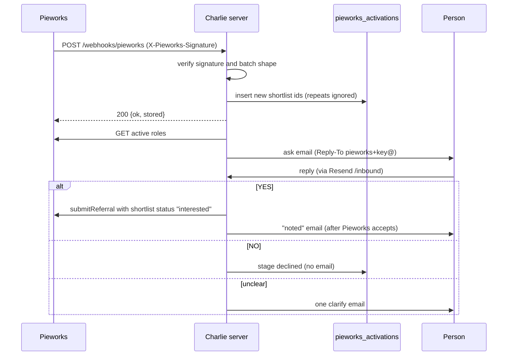

# Pieworks 2call activation

Pieworks keeps a shortlist per role. A person in the **2call** stage is waiting for a call. When a person has waited there for 7 days or more, Pieworks sends them to Charlie. Charlie emails each person once and asks if they are still interested. A "yes" moves the person to **interested** in Pieworks. That is the only status change Charlie makes.

These people belong to Pieworks. They are not onboarded as Charlie job seekers and they do not enter the talent pool. They live only in the `pieworks_activations` table.

Code:

- [lib/pieworks-activation.mjs](../lib/pieworks-activation.mjs): intake, the sweep, reply handling. It is the only reader and writer of `pieworks_activations`.
- [lib/connections/pieworks.mjs](../lib/connections/pieworks.mjs): the Pieworks API client and the webhook signature check.
- [lib/schemas/pieworks.mjs](../lib/schemas/pieworks.mjs): the payload schemas.
- [server/charlie-remote.ts](../server/charlie-remote.ts): the webhook route, the 30-minute timer and the reply branch of `/inbound`.
- [email-kit.mjs](../email-kit.mjs): `renderPieworksAsk`, `renderPieworksReminder`, `renderPieworksClarify`, `renderPieworksNoted`, `renderPieworksStats`.
- Migration [20261026120000_pieworks_activation.sql](../supabase/migrations/20261026120000_pieworks_activation.sql).

## End to end



## 1. The webhook

**Endpoint:** `POST <PUBLIC_BASE_URL>/webhooks/pieworks`

**Signature.** Header `X-Pieworks-Signature: t=<unix seconds>,v1=<hex>`, where `v1 = HMAC-SHA256(PIEWORKS_WEBHOOK_SECRET, "<t>.<raw body>")`. The check (`verifyWebhookSignature`) fails closed:

- no secret configured, no header, or a malformed header: rejected,
- `t` more than 300 seconds from the server clock: rejected,
- a mismatch, compared in constant time: rejected.

A rejected request gets **401**.

**Payload.** A JSON array of candidate records, at most 50 per request. Each record must have:

| Field | Type |
|---|---|
| `shortlistId` | positive integer |
| `requirementId` | positive integer (the Pieworks role id) |
| `name` | non-empty string |
| `emailId` | email address |

Other fields pass through untouched (for example `phoneNo`, `experience`, `source`, `noticePeriod`, an AI score, `aiScoreReason`). A body that is not an array of at most 50 items gets **400**.

**Optional headers:** `Idempotency-Key` (stored on each new row) and `X-Pieworks-Event` (logged).

**Storage.** Each record is parsed alone. A bad record is logged by its `shortlistId` and skipped; the rest are stored. `shortlist_id` is the primary key, so a person Pieworks sends again (it re-sends daily while they stay in 2call) is ignored. Nobody is emailed twice. `aiScoreReason` is kept in its own column and is never emailed or shown to the person.

**Responses:** 200 `{ "ok": true, "stored": <new rows> }`; 401 bad signature; 400 bad shape; 500 if the database write fails (Pieworks retries).

After a 200, the server starts a sweep at once instead of waiting for the next timer.

## 2. The sweep

`runPass()` runs every **30 minutes** on the server, and right after each webhook. One pass runs at a time. Each step is isolated: one failure is logged and counted, and the rest go on.

1. **Ask new rows.** Up to 40 rows in stage `received` per pass. First Charlie reads Pieworks' active roles (`GET {base}/open/activeRoles`). If that read fails, nobody is asked this pass. For each row:
   - role not in the active list: stage `skipped`,
   - Pieworks' own test listing: `skipped`,
   - role status not `hot`, `warm` or `cold`: `skipped`,
   - address suppressed: `skipped`,
   - otherwise the ask email is sent and the stage becomes `emailed`.
2. **Reminder.** One reminder 48 hours after an unanswered ask. Stage `reminded`.
3. **Close.** 48 hours after the reminder (or after an unanswered clarify), the stage becomes `closed`. Nothing is sent.
4. **Retry status updates.** Any `interested` row that Pieworks has not accepted yet is pushed again, up to 5 tries.
5. **Weekly stats.** On Mondays from 04:00 UTC, one stats email to `PIEWORKS_STATS_TO` (emailed, interested, pending, declined, waiting, closed; this week and all time).

The server pings `HEARTBEAT_URL_PIEWORKS` after each pass, with `/fail` when anything failed. Set it on the server if you use heartbeats.

## 3. The candidate email

- **From:** `Pieworks x Charlie <CHARLIE_FROM address>`.
- **Reply-To:** `pieworks+<key>@<CHARLIE_FROM domain>`. The key is 16 random characters, stored as `reply_key`.
- **Subject:** `<First name>, you're on the shortlist for <role> at <company>` (or "you were referred for" when Pieworks' `source` says referral).
- **Body:** the role, company and city from Pieworks' active roles; the pay band, the years band (with the person's own years only when inside the band), and the role's first responsibility, each only when it can be read cleanly. Then: "Still interested? Reply YES ... If it's not right, reply NO".
- **Headers:** one-click `List-Unsubscribe`.
- Every email goes through the [send guard](ARCHITECTURE.md#the-send-guard) with template `pieworks-<kind>` and dedupe key `<shortlist_id>:<kind>`, so each kind is sent at most once per person.

## 4. Replies

Replies arrive through Resend at `/inbound`. The Pieworks branch runs before every other branch, so a reply is never read as a new job seeker.

A reply belongs to a row when:

- it was sent to `pieworks+<key>@`, or
- it was sent to another Charlie address, the sender has an open Pieworks thread, and the subject names that thread's role (for mail apps that ignore Reply-To).

Then:

- Only the person's own address counts. A reply from any other address is ignored.
- The reply is read without the quoted email, greeting and signature (`readYesNo` in [lib/qualify/fields.mjs](../lib/qualify/fields.mjs)). It is read as `yes`, `no` or `unclear`. An unclear reply is never a yes.

| Reply | What happens |
|---|---|
| **YES** | Stage `interested`. Charlie calls `markInterested` right away. When Pieworks accepts, `pushed_at` is set and the "noted" email is sent. If Pieworks does not accept, the sweep retries (up to 5 tries). |
| **NO** | Stage `declined`. Nothing is sent. |
| **Unclear** (first time) | One clarify email asking for YES or NO. Stage `clarified`. |
| **Unclear** (again) | Recorded. Nothing is sent. The row closes 48 hours after the clarify. |
| **No reply** | Reminder at 48 hours, closed at 96 hours. |
| Any reply after a final stage | Recorded only. |

Every reply is stored on the row (`reply_text`, `reply_read`, `replied_at`).

## 5. The status update

`markInterested` in [lib/connections/pieworks.mjs](../lib/connections/pieworks.mjs):

- `POST {PIEWORKS_API_BASE}/recruitment2/open/submitReferral/<requirementId>`
- multipart body with one part, `shortlist`: `{"id": <shortlistId>, "status": {"id": 2, "name": "interested"}}`
- No CV and no candidate part are sent. The schema allows no other status.
- Success is Pieworks' `result: 200`. Anything else counts as not accepted. The request times out after 60 seconds.

## 6. Configuration

| Variable | Purpose |
|---|---|
| `PIEWORKS_ACTIVATION` | `off` (default), `shadow` or `live`. Any other value is `off`. |
| `PIEWORKS_WEBHOOK_SECRET` | HMAC secret for the webhook. Empty means every webhook gets 401. |
| `PIEWORKS_API_BASE` | Pieworks API base URL. |
| `PIEWORKS_API_KEY` | Sent as the `Authorization` header on the active-roles read. |
| `PIEWORKS_REFERRAL_CODE` | Required by the client even though the status update does not send it. |
| `PIEWORKS_STATS_TO` | Recipient of the Monday stats email. Empty means no stats email. |
| `CHARLIE_FROM` | Sender address; its domain is the reply domain. |
| `HEARTBEAT_URL_PIEWORKS` | Optional heartbeat. |

If any of `PIEWORKS_API_BASE`, `PIEWORKS_API_KEY` or `PIEWORKS_REFERRAL_CODE` is empty, every API call throws "not configured" and the pass counts a failure. Nobody is asked, because the roles read fails.

### Modes

| Mode | Webhook | Emails | Status update |
|---|---|---|---|
| `off` | Stores batches | None. The sweep does nothing. | None |
| `shadow` | Stores batches | None. Logs `would send <kind> to <email>` and marks rows `shadow: would ask`. Rows stay `received`. | None. Logs `would move`. |
| `live` | Stores batches | Sent | Sent |

The webhook stores batches in every mode. When you switch from `shadow` to `live`, rows still in `received` are asked on the next pass.

## 7. Test safely

1. **Unit tests.** No network, no database:

   ```sh
   npx vitest run lib/pieworks-activation.test.mjs
   ```

   Under Vitest the Pieworks client refuses any host except `*.test`, `localhost` and `127.0.0.1`, so a test cannot reach the real API.

2. **Signed webhook against a local server** with a test database and `PIEWORKS_ACTIVATION=off`:

   ```sh
   export PIEWORKS_WEBHOOK_SECRET=local-test-secret
   npm run start:remote &
   node -e '
   const { createHmac } = require("node:crypto");
   const body = JSON.stringify([{ shortlistId: 1, requirementId: 1, name: "Test Person", emailId: "you@example.com" }]);
   const t = Math.floor(Date.now() / 1000);
   const v1 = createHmac("sha256", process.env.PIEWORKS_WEBHOOK_SECRET).update(`${t}.${body}`).digest("hex");
   fetch("http://localhost:8787/webhooks/pieworks", { method: "POST", headers: { "content-type": "application/json", "x-pieworks-signature": `t=${t},v1=${v1}` }, body })
     .then(async (r) => console.log(r.status, await r.text()));
   '
   ```

   Expect `200 {"ok":true,"stored":1}`, then `stored":0` if you send it again. Check the row in `pieworks_activations`.

   With no database configured (or one without the migrations), you get `500 {"error":"could not store the batch"}`. That still proves the signature passed: a bad or missing signature is refused with 401 before the body is stored. Only the storage step failed.

   The `&` started the server in the background of your shell. Stop it when you are done: `kill %1` (or `fg`, then Ctrl-C).

3. **Shadow mode.** Set `PIEWORKS_ACTIVATION=shadow` with real API values. Watch the server log for `[pieworks] shadow: would send ask to ...` and `[pieworks] pass: {...}`. Nothing is emailed and nothing changes in Pieworks.

4. **Live with your own address.** Before going live for everyone, send a webhook record with your own address and a real active `requirementId`. Reply YES, NO or something unclear and watch the row's `stage`, `reply_read` and `pushed_at`. Remember that a YES in `live` changes the status in Pieworks.

## Monitoring

- Server log lines start with `[pieworks]`: one line per webhook (`received`, `stored`, `repeats`, `skipped`) and one per pass that did anything.
- Errors go to Sentry with `kind: pieworks-*`.
- After 5 failed status updates for one row, an error is reported to Sentry.
- Query the table for state:

  ```sql
  select stage, count(*) from pieworks_activations group by stage;
  select shortlist_id, email, stage, stage_reason, push_attempts, push_result
  from pieworks_activations where stage = 'interested' and pushed_at is null;
  ```
